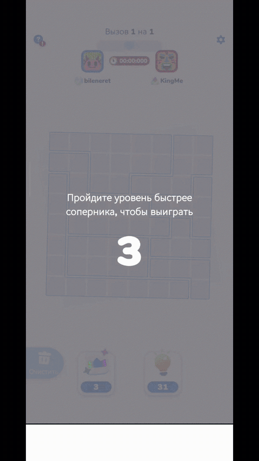
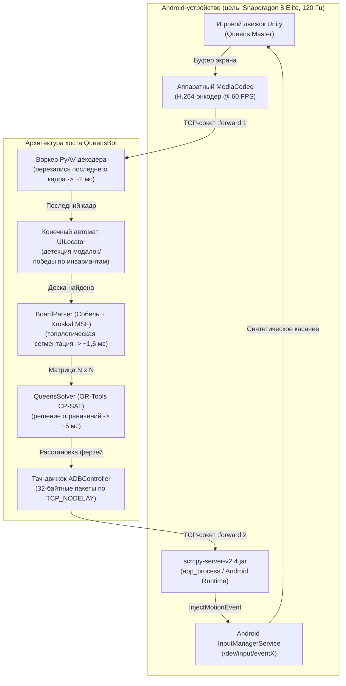

<div align="center">

# QueensBot: низколатентный автономный солвер для Android

[](https://github.com/Bileneret/QueensBot/actions/workflows/ci.yml)
[](https://www.python.org/downloads/)
[](LICENSE)

[](https://vshymanskyy.github.io/StandWithUkraine/)

<a href="https://vshymanskyy.github.io/StandWithUkraine/">
  
</a>

---

[English version](README.md)

---

> Инженерный кейс: реверс тач-подсистем Android, обход IPC-барьеров ОС и построение автономного солвера ограничений, решающего головоломку *Queens Master* быстрее секунды.

<p align="center">
  
</p>

</div>

---

## Коротко

Стандартный инструментарий автоматизации Android (`adb shell input tap`, `uiautomator`, Appium) платит неподъёмную цену за IPC и запуск процессов (~35–45 мс на тап, ~850 мс на захват кадра). На сложных цепочках взаимодействий (например, расстановка 8–11 ферзей двойными тапами по динамическим цветным сеткам) типовое время решения — около **4,60 секунды**.

Система переработана с нуля:

1. Перехват аппаратно ускоренного **H.264-потока через PyAV-декодер внутри процесса** (~2 мс на доступ к кадру),
2. Разбор доски через **фильтр Собеля и минимальный остовный лес (Kruskal MSF)** (~1,6 мс),
3. Решение обобщённой задачи N-ферзей через **Google OR-Tools CP-SAT** (~5 мс),
4. Реверс **бинарного протокола управления Scrcpy v2.4** для микросекундной инъекции тапов (`TCP_NODELAY`),
5. Обход **кванта таймера Windows** (`timeBeginPeriod(1)`) и **различение тач-жестов Unity**,

**Сквозное время решения головоломки срезано с ~4,60 с до ~0,65–0,70 с — ускорение ~7x.**

```
[ Классический ADB-стек ]     ========================================> 4 600 мс
[ QueensBot: быстрее секунды ]  =====> 670 мс (~7x быстрее)
```

---

## Архитектура

Солвер работает как конвейер независимых realtime-подсистем, синхронизированных через общую память и неблокирующий IPC:



### Разбор архитектуры
1. **Низколатентный видеоконвейер**: `scrcpy-server.jar` исполняется внутри контейнера `app_process` Android и слушает абстрактный UNIX-сокет. Видеопакеты декодируются PyAV в отдельном потоке, который хранит только самый свежий кадр (перезапись последнего кадра под локом), поэтому чтение кадра никогда не ждёт в очереди устаревшего видео; задержка доступа остаётся в районе первых миллисекунд.
2. **Топологическая сегментация доски**: извлечение границ локальными градиентными окнами Собеля и разбиение связных клеток на $N$ цветовых регионов через систему непересекающихся множеств (DSU / алгоритм Краскала) за **~1,6 мс**.
3. **Дискретный решатель ограничений**: формулировка в OR-Tools CP-SAT с инвариантами по строкам, столбцам, регионам и расстоянию Чебышёва ($\ge 2$) за **~5 мс**.
4. **Бинарная инъекция касаний**: собственный TCP-сокет-движок, отправляющий 32-байтные пакеты `SC_CONTROL_MSG_TYPE_INJECT_TOUCH_EVENT` напрямую в нативный конвейер событий Android, — **0,046 мс на событие**.

---

## Инженерные находки

### Обход узкого места ввода Android: с 45 мс до 0,046 мс
Вызов `adb shell input tap <x> <y>` запускает удалённый shell-процесс, поднимает runtime `app_process`, создаёт Java-объекты и вызывает `InputManager.injectInputEvent()` через Binder IPC.
* Замеренная цена `adb shell input tap`: **35–45 мс на вызов**.
* Для доски $8 \times 8$ с 8 двойными тапами (16 отдельных событий) стандартный ADB съедает **~1 570 мс** только на форках shell.

**Решение**:
Мы реверсировали [бинарный протокол управления Scrcpy v2.4](https://github.com/Genymobile/scrcpy):
1. Запуск `scrcpy-server` с `control=true, clipboard_autosync=false`.
2. Отдельный TCP-канал через `adb forward tcp:PORT localabstract:scrcpy`.
3. Формирование сырых 32-байтных пакетов (`>BBQiiHHHII`):
   ```python
   # struct.pack('>BBQiiHHHII', type, action, pointer_id, x, y, width, height, pressure, action_button, buttons)
   pkt = struct.pack(
       ">BBQiiHHHII",
       2,                     # SC_CONTROL_MSG_TYPE_INJECT_TOUCH_EVENT
       action,                # 0 = AMOTION_EVENT_ACTION_DOWN, 1 = ACTION_UP
       pointer_id,            # Виртуальный идентификатор касания (uint64)
       int(x), int(y),        # Беззнаковое координатное пространство
       screen_w, screen_h,    # Размеры кадра
       0xFFFF,                # Нормализованное давление (1.0)
       0, 0
   )
   ```
4. Настройка сокета с `TCP_NODELAY` (отключение алгоритма Нагла).
* **Результат**: задержка инъекции рухнула с **~45 мс** до **0,046 мс** на событие (улучшение ~1000x).

---

### Квант таймера Windows (фикс джиттера 15,6 мс)
В Windows NT штатный квант аппаратного таймера прерываний — `15,625 мс` (64 Гц). Вызов стандартного `time.sleep(0.005)` в Python на практике даёт паузу между **15,6 и 31,2 мс**.

Для высокоскоростных серий двойных тапов (где зазор между DOWN и UP должен быть выверен до 8–10 мс) джиттер планировщика Windows ломал регистрацию тапов.

**Решение**:
Перенастройка разрешения мультимедийного системного таймера Windows при старте интерпретатора:
```python
if sys.platform == "win32":
    import ctypes
    # Запрос разрешения прерываний 1,0 мс у winmm.dll
    ctypes.windll.winmm.timeBeginPeriod(1)
```
Это переводит планировщик ядра NT в высокоразрядный режим: детерминированные микро-паузы с разбросом **< 1,1 мс**.

---

### Различение тач-жестов Unity и изоляция виртуальных указателей
При серии двойных тапов по разным координатам быстрее чем за 100 мс эвристика `InputSystem` и трекинга касаний Unity нередко склеивает быстрые тапы в один непрерывный драг (свайп). В *Queens Master* свайп по клетке ставит «X» (блок-маркер) вместо ферзя.

**Корневая причина**: повторное использование одного и того же `pointer_id` (например, `POINTER_ID_GENERIC_FINGER = -2`) внутри окна состояния касаний заставляет Unity привязать новое событие DOWN к траектории предыдущего контакта.

**Решение**: изоляция виртуальных указателей:
```python
for i, (x, y) in enumerate(coords):
    cell_pointer_id = i  # Уникальный pointer_id на каждый двойной тап
    self.inject_touch(x, y, action=0, pointer_id=cell_pointer_id)
    time.sleep(hold_s)
    self.inject_touch(x, y, action=1, pointer_id=cell_pointer_id)
    time.sleep(interval_s)
    self.inject_touch(x, y, action=0, pointer_id=cell_pointer_id)
    time.sleep(hold_s)
    self.inject_touch(x, y, action=1, pointer_id=cell_pointer_id)
    time.sleep(gap_s)
```
Разные идентификаторы указателей гарантируют, что конвейер MotionEvent Android трактует каждую последовательность тапов как отдельное физическое касание, полностью исключая ложные свайпы.

---

### Барьер 120 Гц против цикла событий Unity
Современные флагманские дисплеи Android обновляются на 120 Гц (кадр каждые **8,33 мс**). Но игровые движки (Unity / Unreal) исполняют цикл обработки ввода внутри колбэков `Update()`, привязанных к внутреннему темпу кадров.
* Инъекция тапов быстрее **~6 мс** заставляла движок пропускать состояние отпускания (`ACTION_UP`), склеивая два физических тапа в одно длинное нажатие.
* **Эмпирическая калибровка**:
  - `hold_s = 0.010 с` (10 мс — гарантирует захват хотя бы одного опроса ввода Unity).
  - `interval_s = 0.042 с` (42 мс — покрывает ~5 кадров при 120 Гц, удовлетворяя порогам двойного тапа).
  - `gap_s = 0.025 с` (25 мс — разделитель между соседними ферзями).
  - Итоговое время расстановки 9 ферзей: **~780 мс** при 100% успешных постановок.

---

## Механика игры и разбор мультиплеера

*Queens Master* (издатель Kwalee) предлагает псевдомногопользовательский режим: дуэли, турниры и гонки на скорость. Реверс клиентского рантайма показывает, что «мультиплеер» здесь целиком синтетический:

1. **Клиентская симуляция**: сетевой анализ подтверждает полное отсутствие peer-to-peer и серверной WebSocket-синхронизации во время активных игровых раундов.
2. **Боты с «резинкой»**: полосами прогресса соперников управляют заранее записанные телеметрийные скрипты, динамически подстраивающиеся под прошедшее время игрока. Если игрок решает клетки быстро, таймер бота искусственно ускоряется, имитируя «клатч»-борьбу.
3. **Дублированные турнирные таймеры**: турнирные сетки работают на псевдослучайных детерминированных генераторах, засеянных локальным временем клиента.
4. **Детерминированная уязвимость**: так как оценка матча полностью локальна, решение уровня быстрее **1,0 с** срабатывает порог авто-победы раньше, чем движок «резинки» успевает отыграть догоняющую кривую.

---

## Было → стало

Замеры на устройстве Xiaomi (Snapdragon 8 Elite, 120 Гц, Android 15 HyperOS):

| Этап конвейера | Базовый ADB | QueensBot | Ускорение |
| --- | --- | --- | --- |
| **1. Захват кадра** | ~850,0 мс (`screencap -p`) | **~2,1 мс** (PyAV, H.264-поток) | **~400x** |
| **2. CV-разбор доски** | ~660,0 мс (`cv2.kmeans` + маски) | **~1,6 мс** (Собель + Kruskal MSF) | **~410x** |
| **3. Решатель ограничений** | ~15,0 мс (перебор на Python) | **~5,2 мс** (OR-Tools CP-SAT, C++) | **~3x** |
| **4. Расстановка 8Q** | ~1 570,0 мс (`adb input tap`) | **~780,0 мс** (бинарный сокет, пачкой) | **~2x (100% попаданий)** |
| **5. Издержки верификации** | ~1 500,0 мс (мультикадровый поллинг) | **0,0 мс** (разомкнутый контур — детерминированное решение CP-SAT + калиброванный темп тапов 120 Гц) | **мгновенно** |
| **Полный цикл решения** | **~4 600,0 мс (~4,6 с)** | **~670,0 мс (~0,67 с)** | **~7x суммарно** |

---

## Структура проекта

```
QueensBot/
├── adb_controller.py      # Ядро ADB и бинарного стрим/контрол-движка Scrcpy v2.4
├── board_parser.py        # Микросекундное CV и сегментация Kruskal MSF
├── queens_solver.py       # Решатель ограничений Google OR-Tools CP-SAT
├── ui_locator.py          # Детерминированный локатор UI-якорей и автомат модалок
├── main.py                # CLI-раннер и автономный speedrun-вотчдог
├── benchmark_stream.py    # Профайлер задержек и пропускной способности H.264-потока
├── benchmark_speedrun.py  # Сквозной end-to-end бенчмарк
├── debug_screen.png       # Референсный кадр доски для офлайн-демо (синтетический; пересоздаётся при отсутствии)
├── tests/test_offline.py  # Офлайн-смоук-тесты (устройство не требуется)
├── .github/workflows/ci.yml  # CI: прогон офлайн-тестов на каждый пуш
├── requirements.txt       # Продовые зависимости (проверены в октябре 2026)
├── .env.example           # Шаблон конфигурации
├── README.md              # Инженерный отчёт (английский)
└── README.ru.md           # Русский перевод этого документа
```

---

## Быстрый старт

### Требования
1. **Python 3.12+** (64-бит).
2. **Android-устройство**:
   - Включены параметры разработчика.
   - Включена **отладка по USB**.
   - Включена **отладка по USB (настройки безопасности)** (*критично для Xiaomi / HyperOS / MIUI, чтобы разрешить программную инъекцию касаний*).
   - Подключение по USB 3.0 или Wi-Fi 5 ГГц с низкой задержкой (`adb connect <ip>:<port>`).

> **Замечание о калибровке дисплея:** геометрические эвристики и координаты закрытия модалок откалиброваны под дисплеи 20:9 (1080x2400, например Poco F7 Ultra). Для других пропорций множители координат в `ui_locator.py` можно подстроить.

### Установка
```bash
# Клонирование репозитория
git clone https://github.com/Bileneret/QueensBot.git
cd QueensBot

# Установка зависимостей
pip install -r requirements.txt

# (Опционально) Конфигурация окружения
cp .env.example .env
```

### Тесты (устройство не нужно)
```bash
pip install pytest
pytest tests/test_offline.py -v
```

### Конфигурация (`.env`)
```bash
# Серийник устройства или IP:port (опционально, иначе автоопределение)
ADB_DEVICE_SERIAL=

# Битрейт видеопотока (по умолчанию 6000000 -> 6 Мбит/с)
SCRCPY_BITRATE=6000000

# Частота захвата видео (по умолчанию 30)
SCRCPY_FPS=30
```

### Использование
Запуск солвера через CLI-опции:

```bash
# 1. Один уровень: немедленно решить активную доску
python main.py --single

# 2. Вотчдог спидранна: работает в фоне и решает каждую появившуюся доску
python main.py --watch

# 3. Пакетная автоматизация: решить N уровней подряд с автопереходами
python main.py --auto 10

# 4. Конкретное ADB-устройство по Wi-Fi
python main.py --serial <phone-ip>:5555 --watch
```

---

## Благодарности и дисклеймер

*Репозиторий предназначен строго для академических, образовательных и системно-инженерных исследований (реверс низколатентного мобильного стриминга и подсистем ввода). Все игровые ассеты и торговые марки принадлежат их правообладателям.*

## Лицензия

[MIT](LICENSE)
